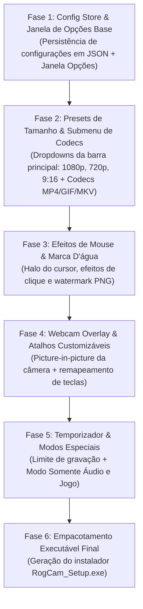

# Product Requirements Document (PRD) - RogCam

**Versão:** 1.0  
**Data:** 17 de Outubro de 2026  
**Status:** Aprovado para Planejamento  
**Referência Base:** Software oCam (OhSoft)  

---

## 1. Visão Geral do Produto

O **RogCam** é um software de desktop para Windows dedicado à gravação de tela, captura de jogos, gravação de áudio e screenshots instantâneas. Projetado como uma evolução moderna, de alto desempenho e esteticamente refinada do clássico **oCam**, o RogCam combina:
- **100% de operação offline:** Sem telemetria, sem anúncios intrusivos e sem necessidade de conexão com a internet.
- **Paridade funcional total:** Replicar com precisão cirúrgica todos os menus, atalhos, codecs e a janela de Opções do oCam original.
- **Design de alta fidelidade:** Interface em *Dark Mode Glassmorphism* com microinterações fluidas, atalhos globais de teclado e o clássico quadro verde delimitador de área (*Bounding Box*).
- **Desempenho contemporâneo:** Pipeline leve alimentado por aceleração de hardware (NVENC/QuickSync/AMF) e FFmpeg nativo x64.

---

## 2. Objetivos e Critérios de Sucesso

| Objetivo | Critério de Sucesso |
| :--- | :--- |
| **Paridade Funcional** | 100% das opções e menus do oCam mapeados e implementados. |
| **Operação Offline** | Funcionar perfeitamente sem qualquer conexão de rede. |
| **Fidelidade de Recorte** | A gravação delimitada pela moldura verde deve gravar estritamente a área interna, pixel a pixel. |
| **Desempenho de Gravação** | Gravação a 30 e 60 FPS com consumo mínimo de CPU (< 8% em repouso / < 18% gravando em H.264). |
| **Facilidade de Uso** | Atalhos rápidos (`F2` para gravar, `F8` para capturar) operantes em segundo plano. |

---

## 3. Personas e Casos de Uso

1. **Criador de Conteúdo / Educador:** Grava tutoriais de software e aulas selecionando janelas específicas, com destaque no ponteiro do mouse e webcam no canto da tela.
2. **Gamer:** Grava partidas em alta taxa de quadros e baixa latência usando atalhos globais de teclado sem interrupção de tela.
3. **Desenvolvedor / Analista:** Grava bugs e fluxos em GIF animado leve ou tira screenshots de áreas específicas para documentação técnica.
4. **Podcaster / Músico:** Grava podcasts ou reuniões usando o modo exclusivo "Gravação de Áudio" para gerar arquivos `.MP3`/`.FLAC`.

---

## 4. Requisitos Funcionais Estruturados

### Módulo 1: Interface Principal & Barra de Ações Rápidas
- **Barra de Título Flutuante:** Minimizar, maximizar e fechar com área de arrasto global (`-webkit-app-region: drag`).
- **Abas de Modo de Operação:**
  - `Gravação de Tela` (Gravação de vídeo da área de trabalho/janela).
  - `Gravação de Jogo` (Captura de janelas de jogos e alta taxa de quadros).
  - `Gravação de Áudio` (Captura pura de som do sistema + microfone gerando MP3/FLAC).
- **Ações Rápidas Centrais:**
  - **Gravar / Parar / Pausar:** Botão circular luminoso com cronômetro digital em tempo real e indicador `● REC`.
  - **Capturar:** Captura instantânea da tela com atalho padrão e salvamento direto.
  - **Tamanho:** Alterna a janela da moldura verde e exibe dropdown com presets de resolução.
  - **Abrir:** Acesso instantâneo com 1 clique à pasta de vídeos/capturas no Windows Explorer.
  - **Codecs (Submenu completo):**
    - `Auto Seleção - Open H.264 + AAC (MP4)`
    - `MP4 (MPEG-4 Part 14) Container`
    - `MKV (Matroska) Container`
    - `M4V (iPod MP4) Container`
    - `MOV (QuickTime) Container`
    - `WMV (Windows Media Video) Container`
    - `FLV (Flash Video) Container`
    - `AVI (Audio Video Interleaved) Container`
    - `TS (MPEG-2 Transport Stream) Container`
    - `VOB (MPEG-2 PS) Container`
    - `GIF Animado (GIF)`
    - `Configurações de codecs de Áudio...`
  - **Som:** Seleção de microfones, ativação do áudio interno (WASAPI Loopback) e equalizador gráfico de LEDs em tempo real.
- **Barra de Status Integrada:**
  - Botão `Menu` (Acesso a Opções, Idioma, Sobre, etc.).
  - Coordenadas de tela ao vivo (`X, Y, Largura, Altura`).
  - Botão Tela Cheia, Controle Deslizante de Volume com gradiente e Engrenagem rápida de opções.

---

### Módulo 2: Moldura de Enquadramento Regional (Bounding Box)
- Janela flutuante transparente, independente e redimensionável.
- Borda tracejada de alta visibilidade com alças de redimensionamento nos 4 cantos.
- Cruzeta central ergonômica para arrastar e reposicionar o enquadramento.
- Tag de resolução ativa (ex: `1920 x 1080`).
- **Comportamento dinâmico na gravação:** Durante o registro, a cruzeta e o badge desaparecem suavemente e a borda muda para vermelho para não poluir o campo visual.

---

### Módulo 3: Janela de Configurações ("Opções")
A janela de opções é dividida em menu lateral com 12 categorias dedicadas:

1. **Gravar (Sub-abas: Geral | Jogos | Redimensionar | Área de Gravação):**
   - Checkboxes: `Incluir o cursor`, `Sempre no topo`, `Usar Área de Notificação`, `Ocultar aplicativo quando minimizado`, `Ocultar aplicativo quando iniciado`.
   - Seção Vídeo: FPS numérico, Qualidade (Baixo/Médio/Alto), Slider de taxa de quadros, Resolução compatível (múltiplos de 8/4) e Modo de taxa de quadros (VFR/CFR).
2. **Som:** Seleção individual de dispositivo de reprodução do sistema (loopback) e dispositivo de gravação (microfone).
3. **Capturar:** Formatos de exportação de imagem (`PNG`, `JPEG`, `GIF`, `BMP`) e opção de incluir ponteiro do cursor.
4. **GIF Animado:** FPS do GIF (padrão 15), opção de redimensionamento embutido (com lista de resoluções prévias e largura/altura manuais) e seleção de qualidade de interpolação.
5. **Atalhos:** Configuração de teclas globais redefiníveis para: `Gravar` (F2), `Pausar` (Shift+F2), `Capturar` (F3/F8), `Alvo` (F4), `Mostrar/Ocultar FPS` (F6), `Mostrar/Ocultar Área à Gravar` (F7).
6. **Efeitos (Sub-abas: Clique Esquerdo | Clique Direito | Realçar Efeito | Cursor):**
   - Efeitos visuais configuráveis para cliques (estilos Anéis/Estrela, seletor de cor, duração da animação, raio/tamanho e espessura da linha).
   - Realce do cursor com halo circular semitransparente colorido.
7. **Salvar:** Definição da pasta de saída, máscara de nomenclatura com tags dinâmicas (`<Prefix>`, `<YYYY>`, `<MM>`, etc.) e numeração sequencial.
8. **Tempo:** Limite de tempo programado com ações automáticas ao finalizar (Nada a fazer, nova gravação, fechar app, desligar PC, hibernar).
9. **Marca D'água:** Sobreposição de imagem PNG transparente com controle de opacidade e posicionamento por grade 3x3.
10. **Webcam:** Ativação de Picture-in-Picture, seleção de dispositivo, formato, tamanho percentual e ancoragem nos 9 pontos da tela com margens configuráveis.
11. **Desempenho:** Configuração de multi-threading, threads do encoder e método de captura de tela.
12. **Linguagem:** Seleção de idiomas (Português, Inglês, Espanhol, etc.).

---

## 5. Requisitos Não-Funcionais
- **Plataforma:** Windows 10 e Windows 11 (64-bit).
- **Latência de Interface:** Resposta a cliques e atalhos em menos de 100ms.
- **Integridade dos Dados:** Gravação com flush periódico para não corromper o arquivo de vídeo em caso de encerramento inesperado.
- **Portabilidade:** Possibilidade de empacotar em um executável autônomo (Portable/Installer).

---

## 6. Roadmap de Implementação Item a Item

