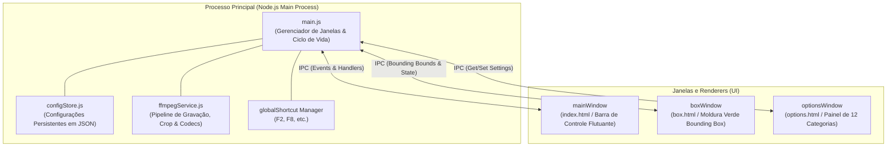
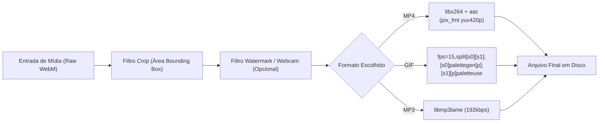

# Technical Specification (SPEC) - RogCam

**Versão:** 1.0  
**Data:** 17 de Outubro de 2026  
**Status:** Pronto para Execução Técnica  

---

## 1. Arquitetura do Sistema

O RogCam adota uma arquitetura desacoplada baseada no ecossistema Electron + Node.js nativo com aceleração FFmpeg. O sistema opera em um modelo multi-janelas com comunicação bidirecional estrita via **IPC (Inter-Process Communication)** segura (`contextIsolation: true`):



---

## 2. Estrutura de Diretórios do Projeto

```text
RogCam/
├── docs/
│   ├── PRD_RogCam.md                 # Documento de Requisitos
│   └── SPEC_RogCam.md                # Especificação Técnica
├── src/
│   ├── main/
│   │   ├── main.js                   # Ponto de entrada do Electron
│   │   ├── configStore.js            # Módulo de persistência (settings.json)
│   │   └── ffmpegService.js          # Módulo wrapper do FFmpeg e conversões
│   ├── preload/
│   │   ├── preload-main.js           # Bridge seguro para a janela principal
│   │   ├── preload-box.js            # Bridge seguro para a janela da moldura verde
│   │   └── preload-options.js        # Bridge seguro para a janela de opções
│   └── renderer/
│       ├── main/
│       │   ├── index.html            # Layout da barra principal
│       │   ├── style.css             # Glassmorphism dark theme
│       │   └── app.js                # Lógica e microinterações
│       ├── box/
│       │   └── box.html              # Layout do Bounding Box
│       └── options/
│           ├── options.html          # Janela com 12 categorias
│           ├── options.css           # Estilo da janela de configurações
│           └── options.js            # Gerenciamento de formulários e abas
├── package.json
└── iniciar_rogcam.bat
```

---

## 3. Esquema de Dados do Armazenamento de Configurações (`config.json`)

As configurações são salvas em `%APPDATA%\RogCam\settings.json` ou localmente no diretório do usuário:

```json
{
  "record": {
    "includeCursor": true,
    "alwaysOnTop": true,
    "useTray": false,
    "hideWhenMinimized": false,
    "hideWhenStarted": false,
    "fps": 30,
    "quality": "high",
    "framerateSlider": 5,
    "resolutionMultiple": "8x4",
    "framerateMode": "vfr"
  },
  "sound": {
    "systemAudio": true,
    "microphone": true,
    "selectedMic": "default"
  },
  "capture": {
    "includeCursor": false,
    "imageFormat": "png"
  },
  "gif": {
    "includeCursor": true,
    "fps": 15,
    "resizeEnabled": false,
    "width": 1280,
    "height": 720,
    "quality": "fast_bilinear"
  },
  "shortcuts": {
    "record": "F2",
    "pause": "Shift+F2",
    "capture": "F8",
    "target": "F4",
    "fpsToggle": "F6",
    "areaToggle": "F7"
  },
  "effects": {
    "leftClick": {
      "enabled": false,
      "style": "rings",
      "color": "#ef4444",
      "duration": 0.5,
      "size": 60,
      "lineWidth": 5
    },
    "rightClick": {
      "enabled": false,
      "style": "rings",
      "color": "#38bdf8",
      "duration": 0.5,
      "size": 60,
      "lineWidth": 5
    },
    "cursorHighlight": {
      "enabled": false,
      "color": "#eab308",
      "opacity": 0.35,
      "radius": 40
    }
  },
  "save": {
    "outputDir": "%USERPROFILE%\\Videos\\RogCam",
    "filenamePattern": "RogCam_<YYYY>_<MM>_<DD>_<HH>_<NN>_<SS>",
    "startNumber": 1
  },
  "timeLimit": {
    "enabled": false,
    "minutes": 10,
    "seconds": 0,
    "onFinish": "do_nothing"
  },
  "webcam": {
    "enabled": false,
    "deviceId": "default",
    "sizePercent": 30,
    "position": "bottom_right",
    "marginX": 2,
    "marginY": 2
  },
  "performance": {
    "useMultiCore": true,
    "encoderThreads": "auto",
    "captureMethod": "desktop_duplication"
  },
  "language": "pt-BR"
}
```

---

## 4. Contratos IPC (Inter-Process Communication)

| Canal IPC | Tipo | Origem ➔ Destino | Payload | Descrição |
| :--- | :--- | :--- | :--- | :--- |
| `get-settings` | `invoke` | Renderer ➔ Main | *(vazio)* | Retorna todo o objeto JSON de configurações. |
| `save-settings` | `invoke` | Options ➔ Main | `Partial<Settings>` | Persiste configurações e aplica atalhos/flags. |
| `open-options-window` | `send` | Main ➔ Main | `category?: string` | Abre a Janela de Opções focando na categoria solicitada. |
| `toggle-bounding-box` | `send` | Renderer ➔ Main | *(vazio)* | Alterna a visibilidade da janela da moldura verde. |
| `set-box-preset` | `send` | Main/Options ➔ Main | `{ width, height }` | Redimensiona e centraliza o Bounding Box para um preset. |
| `recording-state` | `send` | Renderer ➔ Main | `boolean` | Altera visual da moldura verde (oculta mira/borda vermelha). |
| `process-and-save-video` | `invoke` | Renderer ➔ Main | `{ arrayBuffer, format }`| Recebe buffer de mídia, aplica filtros do FFmpeg e salva. |
| `save-screenshot` | `invoke` | Renderer ➔ Main | `{ dataUrl, format }` | Salva imagem em PNG, JPG, BMP ou GIF. |

---

## 5. Pipeline de Codificação do FFmpeg

O processamento de vídeo e recorte dinâmico segue a seguinte pipeline de filtros encadeados:



---

## 6. Plano de Execução Técnica Item a Item

Para mantermos a garantia de funcionamento contínuo, a implementação será feita nas seguintes fases atômicas:

- **Passo 1:** Criação do módulo `configStore.js` (gerenciamento e persistência das configurações).
- **Passo 2:** Implementação do **Menu de Presets de Tamanho** na barra principal (Full Screen, 1080p, 720p, etc.).
- **Passo 3:** Implementação do **Submenu de Codecs** completo com seleção do formato na barra principal.
- **Passo 4:** Criação da **Janela de Opções ("Configurações")** com as 12 categorias mapeadas, abas e persistência de dados.
- **Passo 5:** Conexão dos módulos avançados (Efeitos de mouse, Marca d'água, Webcam e Atalhos customizáveis).
- **Passo 6:** Criação do build de distribuição `.exe` do instalador do RogCam.
